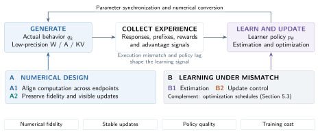
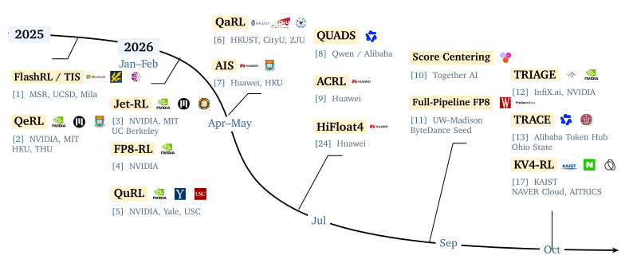
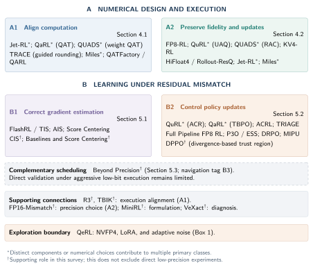
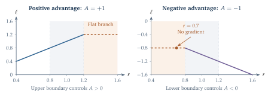

<h1 align="center">Awesome Low-Precision RL</h1>

<p align="center">
  <strong>Training–Rollout Mismatch in Low-Precision LLM Reinforcement Learning: A Survey</strong><br>
  Quantized rollouts · Numerical alignment · Learning under mismatch
</p>

<p align="center">
  <strong>Zunhai Su<sup>1</sup> · Wei Wu<sup>2</sup> · Yifan Zhang<sup>2</sup> · Jianchao Tan<sup>2</sup> · Ngai Wong<sup>1</sup></strong><br>
  <sup>1</sup>The University of Hong Kong &nbsp;·&nbsp; <sup>2</sup>Meituan
</p>

<p align="center">
  
</p>

<p align="center">
  <a href="Survey.pdf"><strong>Read the survey PDF</strong></a> &nbsp;·&nbsp;
  <a href="papers/README.md"><strong>Reading library</strong></a> &nbsp;·&nbsp;
  <a href="#paper-catalog">All papers</a> &nbsp;·&nbsp;
  <a href="docs/MEASUREMENTS.md">Measurements</a> &nbsp;·&nbsp;
  <a href="#citation">Cite</a>
</p>

Quantized rollouts can reduce generation cost, but the sampler and learner may assign different probabilities to the same token even with identical parameters and histories. This training–rollout mismatch can distort gradient estimation and policy updates. The survey organizes recent approaches by intervention target: **numerical design** aligns computation or preserves fidelity and update visibility; **learning under residual mismatch** corrects estimation or controls updates. It compares measurement practices and experimental findings, then examines open problems in lower-cost mitigation, sustained policy improvement, and evaluation at matched quality or end-to-end cost.

<p align="center">
  
</p>

## Contents

[Start here](#start-here) · [Scope](#scope) · [Development](#development-timeline) · [Taxonomy](#taxonomy) · [Measurements](#measuring-mismatch) · [Method comparisons](#comparing-methods) · [Findings](#research-findings) · [Reading routes](#reading-routes) · [Paper catalog](#paper-catalog) · [Contribute](#contribute) · [Citation](#citation)

## Start here

| Your focus | Entry point |
|---|---|
| Learn the background | Survey §§2–3: GRPO policy roles, numerical mismatch, and its effects on learning. |
| Read the key papers | [Core reading route](papers/README.md#core-reading), then the [mechanism-specific routes](#reading-routes). |
| Understand the classification | [Two families and four intervention classes](#taxonomy), with the complete [classification guide](docs/TAXONOMY.md). |
| Interpret reported measurements | [Measurement guide](docs/MEASUREMENTS.md), [source-linked evidence](docs/EVIDENCE.md), and [comparison records](docs/COMPARISONS.md). |

The [numbered reading library](papers/README.md) groups papers by topic and preserves their reading order. Survey roles describe each work's contribution to the synthesis; the core route draws from both topic folders.

## Scope

The collection focuses on the interface between the numerical policy that generates a rollout and the computation used to learn from it. It covers weight, activation, and KV-cache quantization; low precision on one or both endpoints; and closely related work on training–inference mismatch (TIM).

Direct low-precision methods and systems form the core of the collection, supported by work on policy-gradient estimation and general training–inference mismatch. Quantization-assisted exploration provides a related boundary case. The [paper catalog](#paper-catalog) distinguishes these roles.

The survey synthesizes primary-source methods and within-study results. The [neighboring-survey comparison](docs/RELATED_WORK.md#scope-among-surveys) distinguishes this focus from broader rollout lifecycle and efficiency reviews. Numerical formats, architectures, collection protocols, and evaluation rules are recorded alongside the findings. General PTQ, low-precision pretraining, and broader rollout acceleration provide context where they explain this interface.

<details>
<summary><strong>Survey organization: eight sections</strong></summary>

| Section | Purpose |
|---|---|
| 1. Introduction and Scope | Motivate the learner–sampler interface and define the review boundary. |
| 2. Background and Problem Formulation | Separate policy roles, execution mismatch, decoding, and staleness. |
| 3. How Execution Mismatch Affects Learning | Trace probability differences through estimation, clipping, and feedback. |
| 4. Numerical Design and Execution Alignment | Compare computation alignment, fidelity control, and update visibility. |
| 5. Learning under Residual Mismatch | Explain estimator correction and update control, with complementary scheduling and composition. |
| 6. Evidence Synthesis and System Trade-offs | Connect published learning outcomes to evidence and system cost. |
| 7. Open Problems | Develop priorities in sustained stability, composition, mitigation cost, stateful execution, and transfer. |
| 8. Conclusion | Bring numerical fidelity and learning correction into one perspective. |

Appendices collect the paper mapping, source selection, assumptions, terminology, measurement practices, and illustrative examples.

</details>

## Development timeline



Representative milestones follow first public release; chronology does not imply direct technical inheritance. Brief labels highlight selected mechanisms, while marks identify author institutions or teams, with up to three per work. The [figure notes](docs/FIGURES.md#timeline-affiliations-and-organization-marks) give affiliations and mark sources; the [paper catalog](#paper-catalog) provides complete titles and links.

## Taxonomy



Three views connect each method to its experimental results: **mismatch source → intervention target → tested setting**. The source explains why probabilities differ, the target determines the method class, and the setting defines the conditions under which it was evaluated.

**A · Numerical design** changes numerical execution: A1 targets agreement across the two paths; A2 preserves fidelity within a path or the visibility of parameter updates after quantization. **B · Learning under residual mismatch** manages its effect on learning: correct gradient estimation (B1), or control update influence and acceptance (B2). B can preserve useful learning without shrinking the policy gap. The families can be combined within one system.

| Code | Intervention | Main discussion | Representative components |
|---|---|---|---|
| A1 | Align computation between learner and rollout | §4.1 | Jet-RL; QaRL QAT; QUADS weight QAT; TRACE; Miles; QATFactory QARL; R3/TBIK as background |
| A2 | Preserve numerical fidelity and update visibility | §4.2 | QuRL UAQ; QUADS RAC; FP8-RL calibration; KV4-RL protection; Rollout-ResQ; Miles precision exceptions |
| B1 | Correct gradient estimation | §5.1 | FlashRL/TIS; AIS; CIS; Score Centering; baseline/centering theory |
| B2 | Control policy-update influence | §5.2 | QuRL ACR; QaRL TBPO; Calibrated Clipping; P3O; DRPO; MIPU; ACRL; TRIAGE; DPPO as background |

Format, W/A/KV target, architecture, adaptation, and collection schedule are **configuration labels**. Scheduling S (§5.3) is a cross-family complement. QeRL marks the exploration boundary; VeXact supplies a diagnostic reference.

B2 separates the decision rule, its control signal, and its application unit. Batch statistics can inform token-level weights, while whole-policy acceptance evaluates the synchronized candidate. The [classification guide](docs/TAXONOMY.md#control-decisions-inside-b2) relates these decision units to clipping, batch adaptation, constraint geometry, directional control, and candidate acceptance.

The [related-work perspectives](docs/RELATED_WORK.md) connect this framework to how the primary papers organize neighboring work. Their terminology is interpreted alongside each paper's actual mechanism.

## Measuring mismatch

A reported discrepancy is meaningful only with its **policy pair, conditioning, and aggregation**. The studies use complementary measurements:

| Measurement | Representative practice | Interpretation |
|---|---|---|
| Sampled-token log gaps | TRIAGE's mean absolute gap; TRACE's extrema | Summarize disagreement on observed actions, with different sensitivity to tails and population size. |
| Distributional divergence | QuRL's behavior-to-proximal KL; KV4-RL's shared-prefix, full-vocabulary KL | Depend on KL direction, compared policies, and whether prefixes and parameters are fixed. |
| Estimator and update diagnostics | ESS, conditional score drift, sign-conditioned clipping disagreement | Describe weight concentration or the effect of mismatch on learning contributions. |
| Learning and system outcomes | Reward, held-out quality, and complete-loop cost | Establish the learning benefit and cost of an intervention. |

The [measurement guide](docs/MEASUREMENTS.md) compares each core study's definitions and experimental conditions. Controlled numerical probes isolate execution differences, while online diagnostics can also include policy lag and movement after updates. The survey develops this distinction in **§3.4**, connects it to learning results in **§6.2**, and summarizes study-specific practices in **Appendix E**.

## Comparing methods

Method comparisons require the learner path, rollout W/A/KV precision, and evaluation protocol to be read together. Four representative configurations illustrate the differences.

| Work | Mechanism | Reviewed execution setting |
|---|---|---|
| **TRACE**<br>[TRACE: Rollout-Guided Quantization-Aware Training for FP4 Reinforcement Learning of MoE Language Models](https://arxiv.org/abs/2610.07767v2) | Guide learner rounding using rollout quantization information. | Joint NVFP4 expert W4A4 and softmax KV4 rollout; guided fake-quantized learner forward, BF16 backward. |
| **TRIAGE**<br>[TRIAGE: Direction-Aware Mismatch Stabilization of Native NVFP4 Reinforcement Learning](https://arxiv.org/abs/2610.07043v2) | Gate and rebalance selected updates; add bounded repair. | Native NVFP4 W4A4 forward on both endpoints; documented BF16 KV; no reported KV4 experiment. |
| **Score Centering**<br>[Score Centering Stabilizes Off-policy Reinforcement Learning](https://arxiv.org/abs/2609.20807v1) | Center the behavior-weighted score to remove conditional drift. | BF16 learner; quantization stress includes FP4/INT4 KV; policy-lag experiments are separate. |
| **KV4-RL**<br>[KV4-RL: Unlocking Faster Asynchronous Rollouts for RLVR with INT4 KV Cache Quantization](https://arxiv.org/abs/2610.14448v1) | Protect sensitive cache positions at higher precision. | INT4 KV with bounded INT8 protection; BF16 learner; quota-based partial collection. |

TRACE compares TIS+SC under joint NVFP4 W/A/KV rollout; TRIAGE tests recovery beyond TIS under native W4A4, without a direct SC or TRACE comparison. Their results establish benefits within different experimental settings. The [studied combinations](docs/SYNTHESIS.md) explain how alignment, fidelity, correction, and update control interact in tested systems.

[Execution and direct-comparison records](docs/COMPARISONS.md) retain the models, source locations, checkpoint rules, outcomes and limits. The [comparison map](figures/evidence.svg) shows selected within-study connections.

## Research findings

The [source-linked evidence](docs/EVIDENCE.md) connects intervention mechanisms to policy improvement and system cost.

**Alignment depends on what the paths share.** [Jet-RL](https://arxiv.org/abs/2601.14243), [QaRL](https://aclanthology.org/2026.findings-acl.841/), [QUADS](https://arxiv.org/abs/2607.15810), and [TRACE](https://arxiv.org/abs/2610.07767) coordinate different objects: precision flow, quantized representations, or realized rounding. The shared computation determines which discrepancies are addressed and which remain.

**Correction acts on different parts of the update.** [QuRL](https://proceedings.iclr.cc/paper_files/paper/2026/hash/6b4880ced785077159b340710ceb7681-Abstract-Conference.html), [Score Centering](https://arxiv.org/abs/2609.20807), [Full Pipeline FP8 RL](https://arxiv.org/abs/2609.22870), and [TRIAGE](https://arxiv.org/abs/2610.07043) address update visibility, gradient drift, clipping, and direction-dependent control. Comparing these interventions therefore requires identifying which estimation errors or update contributions each changes.

**Learning gains can change during training.** [TRACE](https://arxiv.org/abs/2610.07767v2) reports late degradation for conventional FP4 QAT in its joint W/A/KV setting; [TRIAGE](https://arxiv.org/abs/2610.07043v2) leaves substantially longer training unevaluated. Extended runs can distinguish sustained improvement, postponed deterioration, and stagnation under restrictive control; the [measurement guide](docs/MEASUREMENTS.md#training-duration-and-delayed-instability) develops this distinction.

**Combinations address complementary residual errors.** [QuRL](https://proceedings.iclr.cc/paper_files/paper/2026/hash/6b4880ced785077159b340710ceb7681-Abstract-Conference.html) combines update visibility with clipping control; [QUADS](https://arxiv.org/abs/2607.15810v1) combines weight alignment with activation compensation. The [component analysis](docs/SYNTHESIS.md#mechanism-granularity-and-required-information) connects intervention targets, granularity, and information requirements; the tested bundles retain their original execution and estimator assumptions.

**Efficiency depends on the complete learning loop.** [KV4-RL](https://arxiv.org/abs/2610.14448) reports distinct rollout and full-iteration gains. Calibration, behavior reconstruction, rounding guidance, and weight conversion add dependencies elsewhere in the loop. Section 6 relates these costs to learned-policy quality; the [comparison records](docs/COMPARISONS.md) retain the tested configurations.

Open problems include determining when stress tests predict extended-run failures, adapting control references as the policy evolves, and reducing guidance and control overhead. Quality at a fixed total training budget and cost to a target quality provide complementary comparisons of these trade-offs.

## Reading routes

The catalog is chronological; these routes connect mechanisms. The [numbered reading library](papers/README.md) preserves the local topic groups and provides direct paper access.

| Question | Suggested route | Survey |
|---|---|---|
| What is the mismatch being corrected? | [FlashRL / TIS](https://www.opt-ml.org/papers/2025/paper116.pdf) → [MiniRL](https://arxiv.org/abs/2512.01374) → [VeXact / Diagnosing TIM](https://arxiv.org/abs/2605.14220) | §§2–3 |
| How can the two numerical paths be coupled? | [Jet-RL](https://arxiv.org/abs/2601.14243) → [QaRL](https://aclanthology.org/2026.findings-acl.841/) → [QUADS](https://arxiv.org/abs/2607.15810) → [TRACE](https://arxiv.org/abs/2610.07767) | §4.1 |
| Which information should low precision preserve? | [QuRL](https://proceedings.iclr.cc/paper_files/paper/2026/hash/6b4880ced785077159b340710ceb7681-Abstract-Conference.html) (UAQ) → [FP8-RL](https://arxiv.org/abs/2601.18150) → [HiFloat4 / Rollout-ResQ](https://arxiv.org/abs/2607.26515v1) → [KV4-RL](https://arxiv.org/abs/2610.14448) | §4.2 |
| How should behavior samples estimate a target gradient? | [TIS](https://www.opt-ml.org/papers/2025/paper116.pdf) → [AIS](https://arxiv.org/abs/2605.13907) → [Score Centering](https://arxiv.org/abs/2609.20807), alongside [baseline theory](https://arxiv.org/abs/2610.22263v1); compare [CIS](https://arxiv.org/abs/2609.32444). | §5.1 |
| Which local learning contributions should be retained? | [QuRL](https://proceedings.iclr.cc/paper_files/paper/2026/hash/6b4880ced785077159b340710ceb7681-Abstract-Conference.html) (ACR) → [QaRL](https://aclanthology.org/2026.findings-acl.841/) (TBPO) → [Full Pipeline FP8 RL](https://arxiv.org/abs/2609.22870); then compare [ACRL](https://arxiv.org/abs/2607.24062) and [TRIAGE](https://arxiv.org/abs/2610.07043). | §5.2 |
| How can control extend beyond local clipping? | [DPPO](https://arxiv.org/abs/2602.04879v3) → [DRPO](https://arxiv.org/abs/2606.09821v1) for trust-region geometry; [P3O / ESS](https://arxiv.org/abs/2605.12380v2) for batch reliability; [MIPU](https://arxiv.org/abs/2606.29526v1) for candidate acceptance. | §5.2 |
| What must a deployable low-precision stack coordinate? | [FP8-RL](https://arxiv.org/abs/2601.18150) → [Miles](https://arxiv.org/abs/2609.08368v1) → [QATFactory QARL](https://arxiv.org/abs/2609.39223v2): calibration, conversion, precision exceptions, and weight transfer. | §§4, 6.3 |

Keep [QeRL](https://proceedings.iclr.cc/paper_files/paper/2026/hash/a15a2ece7f0663d1ba7db91103ac61c9-Abstract-Conference.html) visible as an exploration boundary case and [Beyond Precision](https://arxiv.org/abs/2602.01826) as general TIM evidence for scheduling. A route expresses reading dependencies, without implying a performance ranking or historical influence.

## Paper catalog

The tables follow first public appearance, with **complete titles and direct source links**. Conference and preprint versions count as one contribution. The [complete catalog](docs/CATALOG.md) adds authors, reviewed versions, numerical regimes, and discussion locations; [JSON records](data/papers.json) support reuse. First-publication dates can precede the formal publication linked below.

Browse by intervention: [A1 · Alignment](docs/CATALOG.md#alignment-a1) · [A2 · Fidelity](docs/CATALOG.md#fidelity-a2) · [B1 · Estimation](docs/CATALOG.md#estimation-b1) · [B2 · Update control](docs/CATALOG.md#update-control-b2). Complement: [scheduling](docs/CATALOG.md#scheduling-s).

<!-- BEGIN GENERATED CATALOG -->

### Core methods and systems

| First public | Paper | Focus | Class / discussion |
|---|---|---|---|
| 2025 | **FlashRL / TIS**<br>[On the Rollout-Training Mismatch in Modern RL Systems](https://www.opt-ml.org/papers/2025/paper116.pdf) | Recorded behavior probabilities and truncated correction | B1 · 5.1 |
| 2026-01-20 | **Jet-RL**<br>[Jet-RL: Enabling On-Policy FP8 Reinforcement Learning with Unified Training and Rollout Precision Flow](https://arxiv.org/abs/2601.14243v2) | Unified FP8 precision flow | A1; A2 · 4.1 |
| 2026-01-26 | **FP8-RL**<br>[FP8-RL: A Practical and Stable Low-Precision Stack for LLM Reinforcement Learning](https://arxiv.org/abs/2601.18150v2) | W8A8 rollout, FP8 attention/KV, and stack integration | A2; system · 4.2 |
| 2026-02-15 | **QuRL**<br>[QuRL: Low-Precision Reinforcement Learning for Efficient Reasoning](https://proceedings.iclr.cc/paper_files/paper/2026/hash/6b4880ced785077159b340710ceb7681-Abstract-Conference.html) | Adaptive clipping and update-aware quantization | B2; A2 · 5.2 |
| 2026-04-09 | **QaRL**<br>[QaRL: Rollout-Aligned Quantization-Aware RL for Fast and Stable Training under Training–Inference Mismatch](https://aclanthology.org/2026.findings-acl.841/) | Rollout-aligned QAT and trust-band updates | A1; B2 · 4.1 |
| 2026-05-12 | **P3O / ESS**<br>[Let the Batch Decide, On- or Off-Policy: Effective Sample Size for RL Post-Training](https://arxiv.org/abs/2605.12380v2) | Batch-adaptive ESS cap and regularization | B2 · 5.2 |
| 2026-05-13 | **AIS**<br>[AIS: Adaptive Importance Sampling for Quantized RL](https://arxiv.org/abs/2605.13907v1) | Adaptive importance-weighted estimator mixture | B1 · 5.1 |
| 2026-06-08 | **DRPO**<br>[Rethinking the Divergence Regularization in LLM RL](https://arxiv.org/abs/2606.09821v1) | Smooth corrective divergence regularization | B2 · 5.2 |
| 2026-06-28 | **MIPU**<br>[The Mirage of Optimizing Training Policies: Monotonic Inference Policies as the Real Objective for LLM Reinforcement Learning](https://arxiv.org/abs/2606.29526v1) | Inference-policy candidate construction and acceptance | B2; formulation · 5.2 |
| 2026-07-17 | **QUADS**<br>[QUADS: Stabilizing NVFP4 Reinforcement Learning for MoE via QUantization-error Alignment across Dual Sides](https://arxiv.org/abs/2607.15810v1) | NVFP4 MoE weight alignment and activation compensation | A1; A2 · 4.1 |
| 2026-07-27 | **ACRL**<br>[ACRL: Adaptive Control of Training-Inference Discrepancy for Stable Reinforcement Learning](https://arxiv.org/abs/2607.24062v1) | Discrepancy-dependent update control | B2 · 5.2 |
| 2026-07-29 | **HiFloat4 / Rollout-ResQ**<br>[HiFloat4 Format for End-To-End Reinforcement Learning Post-Training of Large Language Models](https://arxiv.org/abs/2607.26515v1) | Sparse residual correction for FP4 rollout activations | A2 · 4.2 |
| 2026-09-08 | **Miles v0.1**<br>[Miles v0.1: Production-Level Post-Training](https://arxiv.org/abs/2609.08368v1) | Shared quantization, synchronization, and precision contracts | A1; A2; system · 4.1 |
| 2026-09-17 | **Score Centering**<br>[Score Centering Stabilizes Off-policy Reinforcement Learning](https://arxiv.org/abs/2609.20807v1) | Additive behavior-weighted score correction | B1 · 5.1 |
| 2026-09-19 | **Full Pipeline FP8 RL**<br>[Towards Full Pipeline FP8 Reinforcement Learning for LLMs](https://arxiv.org/abs/2609.22870v1) | FP8 learner/rollout and calibrated clipping | B2; system · 5.2 |
| 2026-09-30 | **QATFactory / QARL**<br>[QATFactory: A Versatile, Deployment-Aligned Framework for Quantization-aware Training and Distillation of LLMs](https://arxiv.org/abs/2609.39223v2) | Deployment-aligned QARL and inference-ready weight synchronization | A1; system · 4.1 |
| 2026-10-05 | **TRIAGE**<br>[TRIAGE: Direction-Aware Mismatch Stabilization of Native NVFP4 Reinforcement Learning](https://arxiv.org/abs/2610.07043v2) | Direction-aware control for native NVFP4 | B2 · 5.2 |
| 2026-10-06 | **TRACE**<br>[TRACE: Rollout-Guided Quantization-Aware Training for FP4 Reinforcement Learning of MoE Language Models](https://arxiv.org/abs/2610.07767v2) | Rollout-guided FP4 rounding for MoE | A1 · 4.1 |
| 2026-10-10 | **KV4-RL**<br>[KV4-RL: Unlocking Faster Asynchronous Rollouts for RLVR with INT4 KV Cache Quantization](https://arxiv.org/abs/2610.14448v1) | INT4 KV with selective INT8 protection | A2; system · 4.2 |

### Supporting formulation, theory, and general TIM studies

| First public | Paper | Focus | Class / discussion |
|---|---|---|---|
| 2025-10-13 | **R3**<br>[Stabilizing MoE Reinforcement Learning by Aligning Training and Inference Routers](https://arxiv.org/abs/2510.11370v2) | MoE routing alignment | Support; A1 · 3.1 |
| 2025-10-30 | **FP16-Mismatch**<br>[Defeating the Training-Inference Mismatch via FP16](https://arxiv.org/abs/2510.26788v1) | BF16/FP16 precision-selection evidence | Support; A2 · 3.1 |
| 2025-11-21 | **TBIK / Deterministic Inference**<br>[Deterministic Inference across Tensor Parallel Sizes That Eliminates Training-Inference Mismatch](https://arxiv.org/abs/2511.17826v2) | Cross-TP deterministic kernels as an alignment reference | Support; A1 · 3.1 |
| 2025-12-01 | **MiniRL**<br>[Stabilizing Reinforcement Learning with LLMs: Formulation and Practices](https://arxiv.org/abs/2512.01374v3) | Policy roles and mismatch-aware formulation; FP8 experiments | Support; B1/B2 · 2.1 |
| 2026-02-02 | **Beyond Precision**<br>[Beyond Precision: Training-Inference Mismatch is an Optimization Problem and Simple LR Scheduling Fixes It](https://arxiv.org/abs/2602.01826v1) | Optimization schedule under general TIM | Support; S · 5.3 |
| 2026-02-04 | **DPPO**<br>[Rethinking the Trust Region in LLM Reinforcement Learning](https://arxiv.org/abs/2602.04879v3) | Divergence-based trust regions under general TIM | Support; B2 · 5.2 |
| 2026-05-14 | **VeXact / Diagnosing TIM**<br>[Diagnosing Training Inference Mismatch in LLM Reinforcement Learning via a Zero-Mismatch Reference](https://arxiv.org/abs/2605.14220v2) | Zero-mismatch diagnostic reference | Diagnostic · 3.4 |
| 2026-09-26 | **CIS**<br>[Rethinking Training-Inference Mismatch in LLM Reinforcement Learning: Where It Arises and How to Correct It](https://arxiv.org/abs/2609.32444v1) | Confidence-dependent correction under BF16 cross-engine mismatch | Support; B1 · 5.1 |
| 2026-10-15 | **Baselines and Score Centering**<br>[Baselines and Score Centering in Policy Gradient Estimation](https://arxiv.org/abs/2610.22263v1) | Granularity-dependent roles of baselines and score centering | Support; B1 · 5.1 |

### Exploration boundary

| First public | Paper | Focus | Class / discussion |
|---|---|---|---|
| 2025-10-13 | **QeRL**<br>[QeRL: Beyond Efficiency - Quantization-enhanced Reinforcement Learning for LLMs](https://proceedings.iclr.cc/paper_files/paper/2026/hash/a15a2ece7f0663d1ba7db91103ac61c9-Abstract-Conference.html) | NVFP4 with LoRA and adaptive noise; exploration setting. | Boundary · Box 1 |

Roles describe relevance to the survey, rather than evidence quality. Primary and secondary discussion locations are navigation fields; a work can introduce several coequal components.

<!-- END GENERATED CATALOG -->

<details>
<summary><strong>Analytical example: clipping depends on advantage sign</strong></summary>



The curves illustrate the standard surrogate with epsilon 0.2 and advantage ±1. They are analytical constructions, not performance measurements. A negative-advantage token with ratio 0.7 lies on the flat branch; the interpretation depends on which policy ratio is clipped.

</details>

<details>
<summary><strong>Explore the technical figures</strong></summary>

| Figure | What it explains |
|---|---|
| [Development timeline](figures/timeline.svg) | Representative milestones with method citations and author institutions. |
| [Policy identities](figures/policies.svg) | Learner, sampling snapshot, actual behavior, proximal anchor, and KL reference. |
| [Probability trees](figures/prefixes.svg) | Equal local conditionals with different prefix and response probabilities. |
| [Measurement regimes](figures/measurement_practice.svg) | Fixed-checkpoint numerical probes and online update diagnostics, with distinct policy comparisons. |
| [Mechanism map](figures/mechanisms.svg) | Relative influence, score drift, update selection, and feedback. |
| [Quantized-update visibility](figures/quantization.svg) | Why a smaller update can cross a boundary while a larger one remains invisible. |
| [Score centering](figures/centering.svg) | A calculated two-action example separating gradient centering from reward centering. |
| [Rollout-guided rounding](figures/rounding.svg) | Why better cross-path agreement can differ from lower per-path quantization error. |
| [Learning operators](figures/operators.svg) | Estimator correction versus update influence and acceptance, including information requirements and composition. |
| [Direct-comparison map](figures/evidence.svg) | Available comparison sets and their distinct numerical settings. |
| [Timing decomposition](figures/timing.svg) | A constructed example separating rollout acceleration from iteration speedup. |

The figures are available as scalable vector drawings. Constructed numerical examples are labeled separately from published measurements; the [figure notes](docs/FIGURES.md) explain their purposes and assumptions.

</details>

## Contribute

The collection welcomes new work, technical corrections, and research collaborations through [GitHub Issues](https://github.com/ZunhaiSu/awesome-low-precision-rl/issues). Primary sources and precise section/equation references make corrections especially useful. See [contribution guidance](CONTRIBUTING.md) for catalog fields, evidence records, and version handling.

## Citation

Use the citation below or GitHub's **Cite this repository** control, which uses [CITATION.cff](CITATION.cff). Please cite the original papers for their individual results.

```bibtex
@misc{su2026trainingrollout,
  title  = {Training--Rollout Mismatch in Low-Precision LLM Reinforcement Learning: A Survey},
  author = {Su, Zunhai and Wu, Wei and Zhang, Yifan and Tan, Jianchao and Wong, Ngai},
  year   = {2026},
  url    = {https://github.com/ZunhaiSu/awesome-low-precision-rl}
}
```

## Attribution and license

The paper adapts the **typesetting template** from [arXiv:2601.14004v4](https://arxiv.org/abs/2601.14004v4); its scientific framework is specific to this survey. Attribution and modifications are documented in [TEMPLATE.md](docs/TEMPLATE.md).

The survey PDF, repository content, and template adaptations use [CC BY-SA 4.0](LICENSE). Third-party papers and institution marks retain their respective rights; mark sources are documented in the [figure notes](docs/FIGURES.md#timeline-affiliations-and-organization-marks). The [reading library](papers/README.md) provides 11 explicitly licensed PDF mirrors and 18 official-source links, with attribution and version records in [NOTICES](papers/NOTICES.md) and the [manifest](papers/manifest.json).
